# WACRM — Database analysis and schema guide

Generated 2026-10-16 for `D:\Venkat\Zenvy\Whatsapp\wacrm-main`. The companion file
[`wacrm_schema.sql`](./wacrm_schema.sql) is the complete PostgreSQL / Supabase schema.

**How this was produced.** Migrations `001`–`044` were applied in order to a real PostgreSQL 16
server (with stand-ins for the Supabase `auth` and `storage` schemas), migration `045` was rebuilt
(see section 6), and the schema file was generated from the resulting catalog. The generated file
was then loaded into a second empty database and compared object-by-object with the
migration-built one: identical, apart from the optional extra indexes in its section 12 and
the table comments. The source tree (`src/`, about 60 API routes, 24 pages) was scanned for every
`.from('table')`, column reference and `.rpc('function')`.

| Total | Count |
|---|---|
| Application tables | 40 (39 from migrations 001–044, plus `db_maintenance_log` from 045) |
| Columns | 410 |
| Foreign keys | 97 |
| CHECK constraints | 38 |
| Indexes (incl. PK/unique) | 126 |
| RLS policies (public tables) | 110 (+ storage policies) |
| Functions | 33 |
| Triggers | 21 (2 of them on `auth.users`) |
| Enums | 1 (`account_role_enum`) |
| Storage buckets | 3 (`avatars`, `chat-media`, `flow-media`) |
| Realtime tables | 6 |

---

## 1. Application architecture

**Stack.** Next.js 16 (App Router) + React 19 + TypeScript + Tailwind 4 on the front end; Supabase
(PostgreSQL, Auth, Storage, Realtime) as the back end; Meta WhatsApp Cloud API for messaging;
OpenAI / Anthropic (customer-supplied keys) for the AI assistant.

**Request paths** (they decide which database client, and so which security rules, apply):

| Path | Client / identity | RLS |
|---|---|---|
| Dashboard pages and `/api/account`, `/api/ai/*`, `/api/automations`, `/api/flows`, `/api/quick-replies`, `/api/whatsapp/send|config|broadcast|templates` | Server client with the signed-in user's cookie session | Applies |
| `/api/whatsapp/webhook` (Meta), `/api/automations/cron`, `/api/flows/cron`, `/api/automations/engine` | Service-role client | Bypassed |
| `/api/v1/*` (public REST API) | API key looked up by hash, then service-role client scoped to the key's `account_id` | Bypassed — the code must filter by account |
| `/api/platform/*`, `/api/backup?scope=full`, `/api/db-config*` | Service-role client after a platform-role check in TypeScript | Bypassed |

**Tenancy.** One *account* per workspace. `profiles.account_id` + `profiles.account_role`
(owner / admin / agent / viewer) put a user in an account. Nearly every business table carries
`account_id`; RLS policies call `is_account_member(account_id, min_role)`. The older `user_id`
column (creator) is still `NOT NULL` on most tables.

**Platform layer.** Above account roles sits `platform_users` (super_admin / admin1 / admin2 /
subscriber, trial window, allowed tabs). It is enforced in the UI and in the `/api/platform/*`
routes only — see section 6.

---

## 2. Module-to-database mapping

| Module (sidebar / page) | API routes | Tables written | Tables read | RPC / functions |
|---|---|---|---|---|
| Auth, team, invitations (`/login`, `/signup`, `/join/[token]`, Settings → Members) | `api/account/*`, `api/invitations/[token]/*` | `accounts`, `profiles`, `account_invitations`, `member_presence` | same | `handle_new_user`, `peek_invitation`, `redeem_invitation`, `set_member_role`, `remove_account_member`, `transfer_account_ownership`, `touch_presence`, `is_account_member` |
| Subscriptions (Settings → Subscription users) | `api/platform/me`, `api/platform/users` | `platform_users` | `profiles`, `platform_users` | `handle_new_platform_user` |
| WhatsApp setup and templates (Settings → WhatsApp, Broadcasts) | `api/whatsapp/config*`, `api/whatsapp/templates/*`, `api/whatsapp/media/*` | `whatsapp_config`, `message_templates` | same | — |
| Contacts (`/contacts`) | `api/contacts/[id]/tags`, `api/v1/contacts*` | `contacts`, `tags`, `contact_tags`, `custom_fields`, `contact_custom_values`, `contact_notes` | same | `filter_contacts_by_tags`, `merge_duplicate_contacts` |
| Inbox (`/inbox`) | `api/whatsapp/send|react|webhook`, `api/quick-replies*`, `api/v1/conversations*`, `api/v1/messages` | `conversations`, `messages`, `message_reactions`, `quick_replies` (+ storage `chat-media`) | same | `bump_conversation_on_inbound`, `merge_duplicate_conversations`, `notify_conversation_assigned` (trigger) |
| Pipelines (`/pipelines`) | (client queries) | `pipelines`, `pipeline_stages`, `deals` | + `contacts`, `profiles` | — |
| Broadcasts (`/broadcasts`) | `api/whatsapp/broadcast*`, `api/v1/broadcasts*` | `broadcasts`, `broadcast_recipients` | + `contacts`, `message_templates` | `create_broadcast_with_recipients`, `recompute_broadcast_counts`, trigger `broadcast_recipient_aggregate_trigger` |
| Automations (`/automations`) | `api/automations*` (engine, cron) | `automations`, `automation_steps`, `automation_logs`, `automation_pending_executions` | + `contacts`, `conversations`, `deals`, `tags` | `increment_automation_execution_count` |
| Flows / chatbot (`/flows`) | `api/flows*` (activate, runs, cron, templates) | `flows`, `flow_nodes`, `flow_runs`, `flow_run_events` (+ storage `flow-media`) | + `messages`, `contacts` | `increment_flow_execution_count` |
| AI agents and Train AI (`/agents`, `/train-ai`) | `api/ai/*` | `ai_configs`, `ai_knowledge_documents`, `ai_knowledge_chunks`, `ai_usage_log`, `ai_training_profiles`, `ai_training_examples` | + `conversations`, `messages` | `claim_ai_reply_slot`, `match_ai_knowledge_fts`, `match_ai_knowledge_semantic`, `bump_ai_training_use` |
| Public API and webhooks (Settings → API keys / Webhooks) | `api/account/api-keys*`, `api/v1/webhooks*`, `api/v1/me` | `api_keys`, `webhook_endpoints` | same | `record_webhook_failure` |
| Notifications (`/notifications`) | (client queries, Realtime) | `notifications` | same | `notify_conversation_assigned` |
| Dashboard (`/dashboard`) | `lib/dashboard/queries.ts` | — | `conversations`, `messages`, `contacts`, `deals`, `pipeline_stages`, `broadcasts`, `automation_logs`, `ai_usage_log` | — |
| Backup and Database config (Settings → Backup) | `api/backup`, `api/db-config`, `api/db-config/truncate` | `db_maintenance_log` | every table | `db_config_tables`, `db_config_schema_sql`, `db_config_truncate` |
| Guide, Demo | none | none | none | — |

---

## 3. Tables and their purpose

Counts are columns / indexes / RLS policies / foreign keys.

### 1. Accounts, users and team roles

| Table | Purpose | Cols | Idx | RLS pol. | FKs |
|---|---|---|---|---|---|
| `accounts` | Workspace (tenant). Every business table is scoped by account_id. One account per owner (idx_accounts_one_per_owner). | 6 | 2 | 2 | 1 |
| `profiles` | One row per auth user: name, avatar, beta flags, the account the user belongs to and their account_role (owner/admin/agent/viewer). | 11 | 3 | 3 | 2 |
| `account_invitations` | Invite links. Only the SHA-256 token_hash is stored; redeemed through redeem_invitation(). | 10 | 3 | 2 | 3 |
| `member_presence` | Online/away status of each team member per account (Realtime-enabled). | 4 | 2 | 1 | 2 |

### 2. Platform roles and subscriptions

| Table | Purpose | Cols | Idx | RLS pol. | FKs |
|---|---|---|---|---|---|
| `platform_users` | Platform-level role (super_admin/admin1/admin2/subscriber), subscription status, trial window and per-user sidebar tab access. Written only by /api/platform/* under the service role. | 11 | 2 | 1 | 2 |

### 3. WhatsApp connection and message templates

| Table | Purpose | Cols | Idx | RLS pol. | FKs |
|---|---|---|---|---|---|
| `whatsapp_config` | Meta Cloud API connection for an account (one per account, phone_number_id unique across the install). access_token is stored AES-256-GCM encrypted. | 15 | 5 | 4 | 2 |
| `message_templates` | WhatsApp message templates and their Meta approval state (status, meta_template_id, rejection_reason, quality_score). | 22 | 4 | 4 | 2 |

### 4. Contacts, tags and custom fields

| Table | Purpose | Cols | Idx | RLS pol. | FKs |
|---|---|---|---|---|---|
| `contacts` | People the business talks to. phone_normalized is unique per account; wa_user_id / wa_parent_user_id / wa_username hold Meta business-scoped ids. | 14 | 6 | 4 | 2 |
| `tags` | Account-level labels that can be put on contacts. | 6 | 2 | 4 | 2 |
| `contact_tags` | Junction table: contacts <-> tags (many-to-many). | 4 | 4 | 2 | 2 |
| `custom_fields` | Account-defined extra contact fields (name, type, options). | 7 | 2 | 4 | 2 |
| `contact_custom_values` | Junction table: value of a custom field for a contact (one per contact + field). | 5 | 2 | 2 | 2 |
| `contact_notes` | Internal notes written on a contact. | 6 | 2 | 4 | 3 |

### 5. Inbox: conversations, messages and quick replies

| Table | Purpose | Cols | Idx | RLS pol. | FKs |
|---|---|---|---|---|---|
| `conversations` | One thread per contact (unique account_id + contact_id). Holds assignment, status, unread count and AI auto-reply state. | 14 | 5 | 4 | 3 |
| `messages` | Every inbound/outbound/internal message of a conversation, including media, interactive payloads, delivery status and failure details. Realtime-enabled. | 19 | 5 | 2 | 2 |
| `message_reactions` | Emoji reactions by an agent or the contact on a message (one per message + actor). Realtime-enabled. | 7 | 4 | 2 | 2 |
| `quick_replies` | Saved replies (plain text or interactive buttons/lists) agents can insert in the inbox. | 9 | 2 | 4 | 2 |

### 6. Sales pipelines and deals

| Table | Purpose | Cols | Idx | RLS pol. | FKs |
|---|---|---|---|---|---|
| `pipelines` | Kanban sales pipelines. | 5 | 2 | 4 | 2 |
| `pipeline_stages` | Ordered stages (columns) of a pipeline. | 6 | 2 | 2 | 1 |
| `deals` | Opportunities placed in a pipeline stage, linked to a contact and optionally a conversation and an assignee. | 16 | 5 | 4 | 7 |

### 7. Broadcasts

| Table | Purpose | Cols | Idx | RLS pol. | FKs |
|---|---|---|---|---|---|
| `broadcasts` | A template campaign sent to an audience; carries the delivery counters and the delivery lock used by resume. | 19 | 2 | 4 | 2 |
| `broadcast_recipients` | One row per contact in a broadcast with per-recipient status timestamps and wamid; a trigger keeps the broadcast counters in sync. | 12 | 4 | 2 | 2 |

### 8. Automations

| Table | Purpose | Cols | Idx | RLS pol. | FKs |
|---|---|---|---|---|---|
| `automations` | No-code automations: trigger type/config and an execution counter. | 12 | 5 | 4 | 2 |
| `automation_steps` | Steps of an automation, nested by parent_step_id and branch (condition yes/no). | 8 | 3 | 2 | 2 |
| `automation_logs` | One row per automation run with its outcome and the steps executed. | 10 | 4 | 1 | 4 |
| `automation_pending_executions` | Delayed (wait) steps queued to resume at run_at. | 13 | 3 | 0 | 6 |

### 9. Flows (chatbot builder)

| Table | Purpose | Cols | Idx | RLS pol. | FKs |
|---|---|---|---|---|---|
| `flows` | Chatbot flows (visual builder): trigger, entry node, fallback policy. | 14 | 4 | 4 | 2 |
| `flow_nodes` | Nodes of a flow, keyed by node_key with canvas position and JSON config. | 8 | 3 | 2 | 1 |
| `flow_runs` | A contact's progress through a flow; at most one active run per contact (idx_one_active_run_per_contact). Realtime-enabled. | 15 | 5 | 1 | 6 |
| `flow_run_events` | Event log of a flow run, used by the test panel and the errors panel. | 6 | 3 | 1 | 1 |

### 10. AI agent, knowledge base and Train AI

| Table | Purpose | Cols | Idx | RLS pol. | FKs |
|---|---|---|---|---|---|
| `ai_configs` | AI reply assistant settings per account: provider, model, encrypted keys, auto-reply and handoff target. | 14 | 2 | 4 | 3 |
| `ai_knowledge_documents` | Knowledge-base documents (FAQs, policies) the AI answers from. | 7 | 2 | 4 | 2 |
| `ai_knowledge_chunks` | Searchable chunks of a knowledge document: full-text vector (fts) and optional pgvector embedding. | 8 | 5 | 4 | 2 |
| `ai_usage_log` | Token usage of every AI draft/auto-reply, shown on the dashboard. | 10 | 2 | 1 | 2 |
| `ai_training_profiles` | Train AI: one business profile (JSON) per account. | 6 | 2 | 3 | 2 |
| `ai_training_examples` | Train AI: Q&A examples and rules (kind), with usage counter. | 12 | 2 | 4 | 2 |

### 11. Public API and outbound webhooks

| Table | Purpose | Cols | Idx | RLS pol. | FKs |
|---|---|---|---|---|---|
| `api_keys` | Public REST API keys; only the hash and a display prefix are stored. | 11 | 4 | 4 | 2 |
| `webhook_endpoints` | Outbound webhook subscriptions with signing secret and failure counter. | 10 | 2 | 4 | 2 |

### 12. Notifications

| Table | Purpose | Cols | Idx | RLS pol. | FKs |
|---|---|---|---|---|---|
| `notifications` | In-app notifications per user (assignment, mentions). Users may only update read_at. | 11 | 3 | 2 | 5 |

### 13. Database administration (Backup > Database config)

| Table | Purpose | Cols | Idx | RLS pol. | FKs |
|---|---|---|---|---|---|
| `db_maintenance_log` | Audit log of Super-admin database maintenance such as table truncates. Service role only. | 7 | 2 | 0 | 1 |

### Junction / mapping tables

| Table | Links | Uniqueness |
|---|---|---|
| `contact_tags` | `contacts` ⇄ `tags` | `UNIQUE (contact_id, tag_id)` |
| `contact_custom_values` | `contacts` ⇄ `custom_fields` | `UNIQUE (contact_id, custom_field_id)` |
| `profiles` | `auth.users` ⇄ `accounts` (with `account_role`) | `UNIQUE (user_id)` |
| `broadcast_recipients` | `broadcasts` ⇄ `contacts` | none (one row per recipient per send) |
| `message_reactions` | `messages` ⇄ actor (agent or contact) | `UNIQUE (message_id, actor_type, actor_id)` |

---

## 4. Relationships (ERD)

Every table that has an `account_id` points to `accounts`, and every `user_id` / `created_by` /
`assigned_*` column points to `auth.users` (see the full list below); those edges are left out of the
picture to keep it readable.

```mermaid
erDiagram
  ai_knowledge_documents ||--o{ ai_knowledge_chunks : "document_id"
  conversations ||--o{ ai_usage_log : "conversation_id"
  automations ||--o{ automation_logs : "automation_id"
  contacts ||--o{ automation_logs : "contact_id"
  automations ||--o{ automation_pending_executions : "automation_id"
  contacts ||--o{ automation_pending_executions : "contact_id"
  automation_logs ||--o{ automation_pending_executions : "log_id"
  automation_steps ||--o{ automation_pending_executions : "parent_step_id"
  automations ||--o{ automation_steps : "automation_id"
  broadcasts ||--o{ broadcast_recipients : "broadcast_id"
  contacts ||--o{ broadcast_recipients : "contact_id"
  contacts ||--o{ contact_custom_values : "contact_id"
  custom_fields ||--o{ contact_custom_values : "custom_field_id"
  contacts ||--o{ contact_notes : "contact_id"
  contacts ||--o{ contact_tags : "contact_id"
  tags ||--o{ contact_tags : "tag_id"
  contacts ||--o{ conversations : "contact_id"
  profiles ||--o{ deals : "assigned_to"
  contacts ||--o{ deals : "contact_id"
  conversations ||--o{ deals : "conversation_id"
  pipelines ||--o{ deals : "pipeline_id"
  pipeline_stages ||--o{ deals : "stage_id"
  flows ||--o{ flow_nodes : "flow_id"
  flow_runs ||--o{ flow_run_events : "flow_run_id"
  contacts ||--o{ flow_runs : "contact_id"
  conversations ||--o{ flow_runs : "conversation_id"
  flows ||--o{ flow_runs : "flow_id"
  messages ||--o{ flow_runs : "last_prompt_message_id"
  conversations ||--o{ message_reactions : "conversation_id"
  messages ||--o{ message_reactions : "message_id"
  conversations ||--o{ messages : "conversation_id"
  contacts ||--o{ notifications : "contact_id"
  conversations ||--o{ notifications : "conversation_id"
  pipelines ||--o{ pipeline_stages : "pipeline_id"
  accounts ||--o{ profiles : "account_id"
  accounts ||--o{ conversations : "account_id (all business tables)"
```

### Foreign keys (all)

| Child table | Column | Parent | On delete |
|---|---|---|---|
| `account_invitations` | `accepted_by_user_id` | `auth.users` | SET NULL |
| `account_invitations` | `account_id` | `accounts` | CASCADE |
| `account_invitations` | `created_by_user_id` | `auth.users` | SET NULL |
| `accounts` | `owner_user_id` | `auth.users` | RESTRICT |
| `ai_configs` | `account_id` | `accounts` | CASCADE |
| `ai_configs` | `created_by` | `auth.users` | SET NULL |
| `ai_configs` | `handoff_agent_id` | `auth.users` | SET NULL |
| `ai_knowledge_chunks` | `account_id` | `accounts` | CASCADE |
| `ai_knowledge_chunks` | `document_id` | `ai_knowledge_documents` | CASCADE |
| `ai_knowledge_documents` | `account_id` | `accounts` | CASCADE |
| `ai_knowledge_documents` | `created_by` | `auth.users` | SET NULL |
| `ai_training_examples` | `account_id` | `accounts` | CASCADE |
| `ai_training_examples` | `created_by` | `auth.users` | SET NULL |
| `ai_training_profiles` | `account_id` | `accounts` | CASCADE |
| `ai_training_profiles` | `updated_by` | `auth.users` | SET NULL |
| `ai_usage_log` | `account_id` | `accounts` | CASCADE |
| `ai_usage_log` | `conversation_id` | `conversations` | SET NULL |
| `api_keys` | `account_id` | `accounts` | CASCADE |
| `api_keys` | `created_by` | `auth.users` | SET NULL |
| `automation_logs` | `account_id` | `accounts` | CASCADE |
| `automation_logs` | `automation_id` | `automations` | CASCADE |
| `automation_logs` | `contact_id` | `contacts` | SET NULL |
| `automation_logs` | `user_id` | `auth.users` | CASCADE |
| `automation_pending_executions` | `account_id` | `accounts` | CASCADE |
| `automation_pending_executions` | `automation_id` | `automations` | CASCADE |
| `automation_pending_executions` | `contact_id` | `contacts` | SET NULL |
| `automation_pending_executions` | `log_id` | `automation_logs` | CASCADE |
| `automation_pending_executions` | `parent_step_id` | `automation_steps` | SET NULL |
| `automation_pending_executions` | `user_id` | `auth.users` | CASCADE |
| `automation_steps` | `automation_id` | `automations` | CASCADE |
| `automation_steps` | `parent_step_id` | `automation_steps` | CASCADE |
| `automations` | `account_id` | `accounts` | CASCADE |
| `automations` | `user_id` | `auth.users` | CASCADE |
| `broadcast_recipients` | `broadcast_id` | `broadcasts` | CASCADE |
| `broadcast_recipients` | `contact_id` | `contacts` | SET NULL |
| `broadcasts` | `account_id` | `accounts` | CASCADE |
| `broadcasts` | `user_id` | `auth.users` | CASCADE |
| `contact_custom_values` | `contact_id` | `contacts` | CASCADE |
| `contact_custom_values` | `custom_field_id` | `custom_fields` | CASCADE |
| `contact_notes` | `account_id` | `accounts` | CASCADE |
| `contact_notes` | `contact_id` | `contacts` | CASCADE |
| `contact_notes` | `user_id` | `auth.users` | CASCADE |
| `contact_tags` | `contact_id` | `contacts` | CASCADE |
| `contact_tags` | `tag_id` | `tags` | CASCADE |
| `contacts` | `account_id` | `accounts` | CASCADE |
| `contacts` | `user_id` | `auth.users` | CASCADE |
| `conversations` | `account_id` | `accounts` | CASCADE |
| `conversations` | `contact_id` | `contacts` | CASCADE |
| `conversations` | `user_id` | `auth.users` | CASCADE |
| `custom_fields` | `account_id` | `accounts` | CASCADE |
| `custom_fields` | `user_id` | `auth.users` | CASCADE |
| `db_maintenance_log` | `performed_by` | `auth.users` | SET NULL |
| `deals` | `account_id` | `accounts` | CASCADE |
| `deals` | `assigned_to` | `profiles` | SET NULL |
| `deals` | `contact_id` | `contacts` | SET NULL |
| `deals` | `conversation_id` | `conversations` | NO ACTION |
| `deals` | `pipeline_id` | `pipelines` | CASCADE |
| `deals` | `stage_id` | `pipeline_stages` | NO ACTION |
| `deals` | `user_id` | `auth.users` | CASCADE |
| `flow_nodes` | `flow_id` | `flows` | CASCADE |
| `flow_run_events` | `flow_run_id` | `flow_runs` | CASCADE |
| `flow_runs` | `account_id` | `accounts` | CASCADE |
| `flow_runs` | `contact_id` | `contacts` | SET NULL |
| `flow_runs` | `conversation_id` | `conversations` | SET NULL |
| `flow_runs` | `flow_id` | `flows` | CASCADE |
| `flow_runs` | `last_prompt_message_id` | `messages` | SET NULL |
| `flow_runs` | `user_id` | `auth.users` | CASCADE |
| `flows` | `account_id` | `accounts` | CASCADE |
| `flows` | `user_id` | `auth.users` | CASCADE |
| `member_presence` | `account_id` | `accounts` | CASCADE |
| `member_presence` | `user_id` | `auth.users` | CASCADE |
| `message_reactions` | `conversation_id` | `conversations` | CASCADE |
| `message_reactions` | `message_id` | `messages` | CASCADE |
| `message_templates` | `account_id` | `accounts` | CASCADE |
| `message_templates` | `user_id` | `auth.users` | CASCADE |
| `messages` | `conversation_id` | `conversations` | CASCADE |
| `messages` | `reply_to_message_id` | `messages` | SET NULL |
| `notifications` | `account_id` | `accounts` | CASCADE |
| `notifications` | `actor_user_id` | `auth.users` | SET NULL |
| `notifications` | `contact_id` | `contacts` | SET NULL |
| `notifications` | `conversation_id` | `conversations` | CASCADE |
| `notifications` | `user_id` | `auth.users` | CASCADE |
| `pipeline_stages` | `pipeline_id` | `pipelines` | CASCADE |
| `pipelines` | `account_id` | `accounts` | CASCADE |
| `pipelines` | `user_id` | `auth.users` | CASCADE |
| `platform_users` | `updated_by` | `auth.users` | SET NULL |
| `platform_users` | `user_id` | `auth.users` | CASCADE |
| `profiles` | `account_id` | `accounts` | CASCADE |
| `profiles` | `user_id` | `auth.users` | CASCADE |
| `quick_replies` | `account_id` | `accounts` | CASCADE |
| `quick_replies` | `user_id` | `auth.users` | CASCADE |
| `tags` | `account_id` | `accounts` | CASCADE |
| `tags` | `user_id` | `auth.users` | CASCADE |
| `webhook_endpoints` | `account_id` | `accounts` | CASCADE |
| `webhook_endpoints` | `created_by` | `auth.users` | SET NULL |
| `whatsapp_config` | `account_id` | `accounts` | CASCADE |
| `whatsapp_config` | `user_id` | `auth.users` | CASCADE |

---

## 5. Constraints, indexes, triggers, functions and RLS

### 5.1 Unique constraints and unique indexes

| Table | Name | Definition |
|---|---|---|
| `account_invitations` | `account_invitations_token_hash_key` | `(token_hash)` |
| `accounts` | `idx_accounts_one_per_owner` | `(owner_user_id)` |
| `ai_configs` | `ai_configs_account_id_key` | `(account_id)` |
| `ai_training_profiles` | `ai_training_profiles_account_id_key` | `(account_id)` |
| `api_keys` | `api_keys_key_hash_key` | `(key_hash)` |
| `broadcast_recipients` | `idx_broadcast_recipients_wamid` | `(whatsapp_message_id) WHERE (whatsapp_message_id IS NOT NULL)` |
| `contact_custom_values` | `contact_custom_values_contact_id_custom_field_id_key` | `(contact_id, custom_field_id)` |
| `contact_tags` | `contact_tags_contact_id_tag_id_key` | `(contact_id, tag_id)` |
| `contacts` | `idx_contacts_account_phone_normalized` | `(account_id, phone_normalized) WHERE (phone_normalized <> ''::text)` |
| `contacts` | `idx_contacts_account_wa_user_id` | `(account_id, wa_user_id) WHERE (wa_user_id IS NOT NULL)` |
| `conversations` | `idx_conversations_account_contact` | `(account_id, contact_id)` |
| `flow_nodes` | `flow_nodes_flow_id_node_key_key` | `(flow_id, node_key)` |
| `flow_runs` | `idx_one_active_run_per_contact` | `(account_id, contact_id) WHERE (status = 'active'::text)` |
| `message_reactions` | `message_reactions_message_id_actor_type_actor_id_key` | `(message_id, actor_type, actor_id)` |
| `message_templates` | `message_templates_user_name_language_key` | `(user_id, name, language)` |
| `messages` | `idx_messages_conversation_message_id` | `(conversation_id, message_id)` |
| `profiles` | `profiles_user_id_key` | `(user_id)` |
| `whatsapp_config` | `whatsapp_config_account_id_key` | `(account_id)` |
| `whatsapp_config` | `whatsapp_config_phone_number_id_key` | `(phone_number_id)` |

Plus primary keys on every table (`uuid DEFAULT gen_random_uuid()`, except `member_presence`
whose key is `(user_id, account_id)`).

### 5.2 CHECK constraints (the enum-like text columns)

| Table | Constraint | Rule |
|---|---|---|
| `account_invitations` | `account_invitations_role_check` | `CHECK ((role <> 'owner'::account_role_enum))` |
| `accounts` | `accounts_default_currency_format` | `CHECK ((default_currency ~ '^[A-Z]{3}$'::text))` |
| `ai_configs` | `ai_configs_auto_reply_max_per_conversation_check` | `CHECK (((auto_reply_max_per_conversation >= 1) AND (auto_reply_max_per_conversation <= 20)))` |
| `ai_configs` | `ai_configs_provider_check` | `CHECK ((provider = ANY (ARRAY['openai'::text, 'anthropic'::text])))` |
| `ai_training_examples` | `ai_training_examples_check` | `CHECK (((kind = 'rule'::text) OR ((question IS NOT NULL) AND (length(TRIM(BOTH FROM question)) > 0))))` |
| `ai_training_examples` | `ai_training_examples_kind_check` | `CHECK ((kind = ANY (ARRAY['qa'::text, 'rule'::text])))` |
| `ai_training_examples` | `ai_training_examples_source_check` | `CHECK ((source = ANY (ARRAY['manual'::text, 'conversation'::text, 'import'::text])))` |
| `ai_usage_log` | `ai_usage_log_mode_check` | `CHECK ((mode = ANY (ARRAY['auto_reply'::text, 'draft'::text])))` |
| `ai_usage_log` | `ai_usage_log_provider_check` | `CHECK ((provider = ANY (ARRAY['openai'::text, 'anthropic'::text])))` |
| `automation_logs` | `automation_logs_status_check` | `CHECK ((status = ANY (ARRAY['success'::text, 'partial'::text, 'failed'::text])))` |
| `automation_pending_executions` | `automation_pending_executions_branch_check` | `CHECK ((branch = ANY (ARRAY['yes'::text, 'no'::text])))` |
| `automation_pending_executions` | `automation_pending_executions_status_check` | `CHECK ((status = ANY (ARRAY['pending'::text, 'running'::text, 'done'::text, 'failed'::text])))` |
| `automation_steps` | `automation_steps_branch_check` | `CHECK ((branch = ANY (ARRAY['yes'::text, 'no'::text])))` |
| `broadcast_recipients` | `broadcast_recipients_status_check` | `CHECK ((status = ANY (ARRAY['pending'::text, 'sent'::text, 'delivered'::text, 'read'::text, 'replied'::text, 'failed'::text])))` |
| `broadcasts` | `broadcasts_status_check` | `CHECK ((status = ANY (ARRAY['draft'::text, 'scheduled'::text, 'sending'::text, 'sent'::text, 'failed'::text])))` |
| `conversations` | `conversations_status_check` | `CHECK ((status = ANY (ARRAY['open'::text, 'pending'::text, 'closed'::text])))` |
| `deals` | `deals_status_check` | `CHECK ((status = ANY (ARRAY['open'::text, 'won'::text, 'lost'::text])))` |
| `flow_nodes` | `flow_nodes_node_type_check` | `CHECK ((node_type = ANY (ARRAY['start'::text, 'send_buttons'::text, 'send_list'::text, 'send_message'::text, 'send_media'::text, 'collect_input'::text, 'condition'::text, 'set_tag'::text, 'handoff'::text, 'http_fetch'::text, 'end'::text])))` |
| `flow_run_events` | `flow_run_events_event_type_check` | `CHECK ((event_type = ANY (ARRAY['started'::text, 'node_entered'::text, 'message_sent'::text, 'reply_received'::text, 'fallback_fired'::text, 'handoff'::text, 'timeout'::text, 'error'::text, 'completed'::text])))` |
| `flow_runs` | `flow_runs_status_check` | `CHECK ((status = ANY (ARRAY['active'::text, 'completed'::text, 'handed_off'::text, 'timed_out'::text, 'paused_by_agent'::text, 'failed'::text])))` |
| `flows` | `flows_status_check` | `CHECK ((status = ANY (ARRAY['draft'::text, 'active'::text, 'archived'::text])))` |
| `flows` | `flows_trigger_type_check` | `CHECK ((trigger_type = ANY (ARRAY['keyword'::text, 'first_inbound_message'::text, 'manual'::text])))` |
| `member_presence` | `member_presence_status_check` | `CHECK ((status = ANY (ARRAY['online'::text, 'away'::text])))` |
| `message_reactions` | `message_reactions_actor_type_check` | `CHECK ((actor_type = ANY (ARRAY['customer'::text, 'agent'::text])))` |
| `message_templates` | `message_templates_buttons_shape_check` | `CHECK (((buttons IS NULL) OR ((jsonb_typeof(buttons) = 'array'::text) AND (jsonb_array_length(buttons) <= 10))))` |
| `message_templates` | `message_templates_category_check` | `CHECK ((category = ANY (ARRAY['Marketing'::text, 'Utility'::text, 'Authentication'::text])))` |
| `message_templates` | `message_templates_header_type_check` | `CHECK ((header_type = ANY (ARRAY['text'::text, 'image'::text, 'video'::text, 'document'::text])))` |
| `message_templates` | `message_templates_quality_score_check` | `CHECK (((quality_score IS NULL) OR (quality_score = ANY (ARRAY['GREEN'::text, 'YELLOW'::text, 'RED'::text]))))` |
| `message_templates` | `message_templates_status_meta_check` | `CHECK ((status = ANY (ARRAY['DRAFT'::text, 'PENDING'::text, 'APPROVED'::text, 'REJECTED'::text, 'PAUSED'::text, 'DISABLED'::text, 'IN_APPEAL'::text, 'PENDING_DELETION'::text])))` |
| `messages` | `messages_content_type_check` | `CHECK ((content_type = ANY (ARRAY['text'::text, 'image'::text, 'document'::text, 'audio'::text, 'video'::text, 'location'::text, 'template'::text, 'interactive'::text])))` |
| `messages` | `messages_sender_type_check` | `CHECK ((sender_type = ANY (ARRAY['customer'::text, 'agent'::text, 'bot'::text])))` |
| `messages` | `messages_status_check` | `CHECK ((status = ANY (ARRAY['sending'::text, 'sent'::text, 'delivered'::text, 'read'::text, 'failed'::text])))` |
| `notifications` | `notifications_type_check` | `CHECK ((type = 'conversation_assigned'::text))` |
| `platform_users` | `platform_users_platform_role_check` | `CHECK ((platform_role = ANY (ARRAY['super_admin'::text, 'admin1'::text, 'admin2'::text, 'subscriber'::text])))` |
| `platform_users` | `platform_users_subscription_status_check` | `CHECK ((subscription_status = ANY (ARRAY['trial'::text, 'active'::text, 'expired'::text, 'suspended'::text])))` |
| `platform_users` | `platform_users_trial_days_check` | `CHECK (((trial_days IS NULL) OR (trial_days = ANY (ARRAY[1, 7, 15]))))` |
| `quick_replies` | `quick_replies_kind_check` | `CHECK ((kind = ANY (ARRAY['text'::text, 'interactive'::text])))` |
| `whatsapp_config` | `whatsapp_config_status_check` | `CHECK ((status = ANY (ARRAY['connected'::text, 'disconnected'::text])))` |

### 5.3 Indexes (non-unique)

| Table | Index | Definition |
|---|---|---|
| `account_invitations` | `idx_account_invitations_account_pending` | `btree (account_id, expires_at) WHERE (accepted_at IS NULL)` |
| `ai_knowledge_chunks` | `ai_knowledge_chunks_account_id_idx` | `btree (account_id)` |
| `ai_knowledge_chunks` | `ai_knowledge_chunks_document_id_idx` | `btree (document_id)` |
| `ai_knowledge_chunks` | `ai_knowledge_chunks_embedding_idx` | `gin (embedding)` |
| `ai_knowledge_chunks` | `ai_knowledge_chunks_fts_idx` | `gin (fts)` |
| `ai_knowledge_documents` | `ai_knowledge_documents_account_id_idx` | `btree (account_id)` |
| `ai_training_examples` | `idx_ai_training_examples_account` | `btree (account_id, kind, is_active)` |
| `ai_usage_log` | `idx_ai_usage_log_account_created` | `btree (account_id, created_at DESC)` |
| `api_keys` | `api_keys_account_id_idx` | `btree (account_id)` |
| `api_keys` | `api_keys_key_hash_idx` | `btree (key_hash)` |
| `automation_logs` | `idx_automation_logs_account` | `btree (account_id)` |
| `automation_logs` | `idx_automation_logs_automation` | `btree (automation_id, created_at DESC)` |
| `automation_logs` | `idx_automation_logs_user` | `btree (user_id)` |
| `automation_pending_executions` | `idx_automation_pending_account` | `btree (account_id)` |
| `automation_pending_executions` | `idx_automation_pending_due` | `btree (run_at) WHERE (status = 'pending'::text)` |
| `automation_steps` | `idx_automation_steps_automation_id` | `btree (automation_id, "position")` |
| `automation_steps` | `idx_automation_steps_parent` | `btree (parent_step_id) WHERE (parent_step_id IS NOT NULL)` |
| `automations` | `idx_automations_account` | `btree (account_id)` |
| `automations` | `idx_automations_account_active_trigger` | `btree (account_id, trigger_type) WHERE (is_active = true)` |
| `automations` | `idx_automations_active_trigger` | `btree (trigger_type) WHERE (is_active = true)` |
| `automations` | `idx_automations_user_id` | `btree (user_id)` |
| `broadcast_recipients` | `idx_broadcast_recipients_broadcast` | `btree (broadcast_id)` |
| `broadcast_recipients` | `idx_broadcast_recipients_broadcast_status` | `btree (broadcast_id, status)` |
| `broadcasts` | `idx_broadcasts_account` | `btree (account_id)` |
| `contact_notes` | `idx_contact_notes_account` | `btree (account_id)` |
| `contact_tags` | `idx_contact_tags_contact` | `btree (contact_id)` |
| `contact_tags` | `idx_contact_tags_tag` | `btree (tag_id)` |
| `contacts` | `idx_contacts_account` | `btree (account_id)` |
| `contacts` | `idx_contacts_phone` | `btree (phone)` |
| `contacts` | `idx_contacts_user_id` | `btree (user_id)` |
| `conversations` | `idx_conversations_account` | `btree (account_id)` |
| `conversations` | `idx_conversations_contact_id` | `btree (contact_id)` |
| `conversations` | `idx_conversations_user_id` | `btree (user_id)` |
| `custom_fields` | `idx_custom_fields_account` | `btree (account_id)` |
| `db_maintenance_log` | `idx_db_maintenance_log_created` | `btree (created_at DESC)` |
| `deals` | `idx_deals_account` | `btree (account_id)` |
| `deals` | `idx_deals_assigned_to` | `btree (assigned_to)` |
| `deals` | `idx_deals_pipeline` | `btree (pipeline_id)` |
| `deals` | `idx_deals_stage` | `btree (stage_id)` |
| `flow_nodes` | `idx_flow_nodes_flow` | `btree (flow_id)` |
| `flow_run_events` | `idx_flow_run_events_run_time` | `btree (flow_run_id, created_at DESC)` |
| `flow_run_events` | `idx_flow_run_events_run_type` | `btree (flow_run_id, event_type)` |
| `flow_runs` | `idx_flow_runs_account` | `btree (account_id)` |
| `flow_runs` | `idx_flow_runs_active_advanced` | `btree (last_advanced_at) WHERE (status = 'active'::text)` |
| `flow_runs` | `idx_flow_runs_flow_started` | `btree (flow_id, started_at DESC)` |
| `flows` | `idx_flows_account` | `btree (account_id)` |
| `flows` | `idx_flows_account_active` | `btree (account_id) WHERE (status = 'active'::text)` |
| `flows` | `idx_flows_active_trigger` | `btree (user_id, trigger_type) WHERE (status = 'active'::text)` |
| `member_presence` | `member_presence_account_idx` | `btree (account_id)` |
| `message_reactions` | `idx_message_reactions_conversation` | `btree (conversation_id)` |
| `message_reactions` | `idx_message_reactions_message` | `btree (message_id)` |
| `message_templates` | `idx_message_templates_account` | `btree (account_id)` |
| `message_templates` | `idx_message_templates_meta_template_id` | `btree (meta_template_id) WHERE (meta_template_id IS NOT NULL)` |
| `messages` | `idx_messages_conversation` | `btree (conversation_id)` |
| `messages` | `idx_messages_message_id` | `btree (message_id)` |
| `messages` | `idx_messages_reply_to` | `btree (reply_to_message_id) WHERE (reply_to_message_id IS NOT NULL)` |
| `notifications` | `idx_notifications_user_created` | `btree (user_id, created_at DESC)` |
| `notifications` | `idx_notifications_user_unread` | `btree (user_id) WHERE (read_at IS NULL)` |
| `pipeline_stages` | `idx_pipeline_stages_pipeline` | `btree (pipeline_id)` |
| `pipelines` | `idx_pipelines_account` | `btree (account_id)` |
| `platform_users` | `idx_platform_users_role` | `btree (platform_role)` |
| `profiles` | `idx_profiles_account_role` | `btree (account_id, account_role)` |
| `quick_replies` | `idx_quick_replies_account` | `btree (account_id)` |
| `tags` | `idx_tags_account` | `btree (account_id)` |
| `webhook_endpoints` | `webhook_endpoints_account_id_idx` | `btree (account_id)` |
| `whatsapp_config` | `idx_whatsapp_config_account` | `btree (account_id)` |
| `whatsapp_config` | `idx_whatsapp_config_registered_at` | `btree (registered_at) WHERE (registered_at IS NULL)` |

Notable: `idx_one_active_run_per_contact` (partial unique, one active flow run per contact),
`idx_contacts_account_phone_normalized` and `idx_conversations_account_contact` (duplicate prevention),
GIN on `ai_knowledge_chunks.fts`, HNSW (cosine) on `ai_knowledge_chunks.embedding`.
Section 12 of the schema file adds 12 optional indexes for foreign-key columns that have none.

### 5.4 Triggers

| Table | Trigger | Function | When |
|---|---|---|---|
| `auth.users` | `on_auth_user_created` | `handle_new_user()` | AFTER INSERT |
| `auth.users` | `on_auth_user_created_platform` | `handle_new_platform_user()` | AFTER INSERT |
| `public.accounts` | `set_updated_at` | `update_updated_at_column()` | BEFORE UPDATE |
| `public.ai_configs` | `ai_configs_updated_at` | `update_ai_configs_updated_at()` | BEFORE UPDATE |
| `public.ai_knowledge_documents` | `ai_knowledge_documents_updated_at` | `update_ai_knowledge_documents_updated_at()` | BEFORE UPDATE |
| `public.ai_training_examples` | `set_updated_at` | `update_updated_at_column()` | BEFORE UPDATE |
| `public.ai_training_profiles` | `set_updated_at` | `update_updated_at_column()` | BEFORE UPDATE |
| `public.automations` | `set_updated_at` | `update_updated_at_column()` | BEFORE UPDATE |
| `public.broadcast_recipients` | `broadcast_recipients_aggregate` | `broadcast_recipient_aggregate_trigger()` | AFTER INSERT/UPDATE/DELETE |
| `public.broadcasts` | `set_updated_at` | `update_updated_at_column()` | BEFORE UPDATE |
| `public.contacts` | `set_updated_at` | `update_updated_at_column()` | BEFORE UPDATE |
| `public.conversations` | `on_conversation_assigned` | `notify_conversation_assigned()` | AFTER INSERT/UPDATE |
| `public.conversations` | `set_updated_at` | `update_updated_at_column()` | BEFORE UPDATE |
| `public.deals` | `set_updated_at` | `update_updated_at_column()` | BEFORE UPDATE |
| `public.flows` | `set_updated_at` | `update_updated_at_column()` | BEFORE UPDATE |
| `public.message_templates` | `set_updated_at` | `update_updated_at_column()` | BEFORE UPDATE |
| `public.platform_users` | `set_updated_at` | `update_updated_at_column()` | BEFORE UPDATE |
| `public.profiles` | `enforce_profile_privilege_columns` | `enforce_profile_privilege_columns()` | BEFORE UPDATE |
| `public.profiles` | `set_updated_at` | `update_updated_at_column()` | BEFORE UPDATE |
| `public.quick_replies` | `set_updated_at` | `update_updated_at_column()` | BEFORE UPDATE |
| `public.whatsapp_config` | `set_updated_at` | `update_updated_at_column()` | BEFORE UPDATE |

### 5.5 Functions

| Group | Function | Security | Callable by |
|---|---|---|---|
| Shared helpers | `update_updated_at_column()` | invoker | (default: PUBLIC) |
| Shared helpers | `is_account_member(target_account_id uuid, min_role account_role_enum)` | DEFINER | PUBLIC, authenticated, service_role |
| Accounts, invitations and roles | `handle_new_user()` | DEFINER | (default: PUBLIC) |
| Accounts, invitations and roles | `enforce_profile_privilege_columns()` | invoker | (default: PUBLIC) |
| Accounts, invitations and roles | `peek_invitation(p_token_hash text)` | DEFINER | anon, authenticated |
| Accounts, invitations and roles | `redeem_invitation(p_token_hash text)` | DEFINER | authenticated |
| Accounts, invitations and roles | `set_member_role(p_user_id uuid, p_new_role account_role_enum)` | DEFINER | authenticated |
| Accounts, invitations and roles | `remove_account_member(p_user_id uuid)` | DEFINER | authenticated |
| Accounts, invitations and roles | `transfer_account_ownership(p_new_owner_user_id uuid)` | DEFINER | authenticated |
| Accounts, invitations and roles | `touch_presence(p_status text)` | DEFINER | (default: PUBLIC) |
| Platform subscriptions | `handle_new_platform_user()` | DEFINER | (default: PUBLIC) |
| Contacts and inbox | `filter_contacts_by_tags(p_tag_ids uuid[], p_search text, p_limit integer, p_offset integer)` | invoker | authenticated |
| Contacts and inbox | `merge_duplicate_contacts()` | DEFINER | (default: PUBLIC) |
| Contacts and inbox | `merge_duplicate_conversations()` | DEFINER | (default: PUBLIC) |
| Contacts and inbox | `bump_conversation_on_inbound(p_conversation_id uuid, p_last_message_text text)` | DEFINER | service_role |
| Contacts and inbox | `notify_conversation_assigned()` | DEFINER | (default: PUBLIC) |
| Broadcasts | `create_broadcast_with_recipients(p_account_id uuid, p_user_id uuid, p_name text, p_template_name text, p_template_language text, p_total_recipients integer, p_contact_ids uuid[], p_template_params jsonb[])` | DEFINER | service_role |
| Broadcasts | `recompute_broadcast_counts(bid uuid)` | DEFINER | (default: PUBLIC) |
| Broadcasts | `broadcast_recipient_aggregate_trigger()` | DEFINER | (default: PUBLIC) |
| Broadcasts | `_bcast_bump(bid uuid, col text, delta integer)` | DEFINER | (default: PUBLIC) |
| Broadcasts | `_bcast_cols_for_status(s text)` | invoker | (default: PUBLIC) |
| Automations and flows | `increment_automation_execution_count(p_automation_id uuid)` | DEFINER | service_role |
| Automations and flows | `increment_flow_execution_count(p_flow_id uuid)` | DEFINER | service_role |
| AI and Train AI | `claim_ai_reply_slot(conversation_id uuid, max_replies integer)` | DEFINER | PUBLIC, service_role |
| AI and Train AI | `match_ai_knowledge_fts(p_account_id uuid, p_query text, p_match_count integer)` | invoker | authenticated, service_role |
| AI and Train AI | `match_ai_knowledge_semantic(p_account_id uuid, p_query_embedding text, p_match_count integer)` | invoker | authenticated, service_role |
| AI and Train AI | `update_ai_configs_updated_at()` | invoker | (default: PUBLIC) |
| AI and Train AI | `update_ai_knowledge_documents_updated_at()` | invoker | (default: PUBLIC) |
| AI and Train AI | `bump_ai_training_use(p_ids uuid[])` | DEFINER | PUBLIC, authenticated, service_role |
| Webhooks | `record_webhook_failure(endpoint_id uuid, max_failures integer)` | DEFINER | (default: PUBLIC) |
| Database config (migration 045, REBUILT) | `db_config_tables()` | DEFINER | service_role |
| Database config (migration 045, REBUILT) | `db_config_schema_sql()` | DEFINER | service_role |
| Database config (migration 045, REBUILT) | `db_config_truncate(p_tables text[])` | DEFINER | service_role |

### 5.6 Row Level Security requirements

* RLS is **enabled on all 40 tables.** Helper: `is_account_member(account_id, min_role)` with the order
  owner > admin > agent > viewer.
* Reading data is generally open to every member of the account; changing settings-class data
  (`whatsapp_config`, `ai_configs`, `api_keys`, `webhook_endpoints`, `ai_knowledge_*`,
  `ai_training_*`) needs admin or owner.
* Tables with a `SELECT`-only policy (writes only by the server with the service role):
  `automation_logs`, `flow_runs`, `flow_run_events`, `ai_usage_log`, `member_presence`, `platform_users`
  (own row only). `notifications` has SELECT and UPDATE policies for the owner, and a column grant limits UPDATE to `read_at`.
* `automation_pending_executions` and `db_maintenance_log` have RLS on and **no policy**: nobody except the
  service role can touch them.
* `profiles`: `enforce_profile_privilege_columns` stops a user from changing their own `account_id`,
  `account_role` (migration 034; the legacy `role` column is not guarded).

| Table | Policies |
|---|---|
| `account_invitations` | `account_invitations_modify` (ALL); `account_invitations_select` (SELECT) |
| `accounts` | `accounts_select` (SELECT); `accounts_update` (UPDATE) |
| `ai_configs` | `ai_configs_delete` (DELETE); `ai_configs_insert` (INSERT); `ai_configs_select` (SELECT); `ai_configs_update` (UPDATE) |
| `ai_knowledge_chunks` | `ai_knowledge_chunks_delete` (DELETE); `ai_knowledge_chunks_insert` (INSERT); `ai_knowledge_chunks_select` (SELECT); `ai_knowledge_chunks_update` (UPDATE) |
| `ai_knowledge_documents` | `ai_knowledge_documents_delete` (DELETE); `ai_knowledge_documents_insert` (INSERT); `ai_knowledge_documents_select` (SELECT); `ai_knowledge_documents_update` (UPDATE) |
| `ai_training_examples` | `ai_training_examples_delete` (DELETE); `ai_training_examples_insert` (INSERT); `ai_training_examples_select` (SELECT); `ai_training_examples_update` (UPDATE) |
| `ai_training_profiles` | `ai_training_profiles_insert` (INSERT); `ai_training_profiles_select` (SELECT); `ai_training_profiles_update` (UPDATE) |
| `ai_usage_log` | `ai_usage_log_select` (SELECT) |
| `api_keys` | `api_keys_delete` (DELETE); `api_keys_insert` (INSERT); `api_keys_select` (SELECT); `api_keys_update` (UPDATE) |
| `automation_logs` | `automation_logs_select` (SELECT) |
| `automation_pending_executions` | none (deny-all except service role) |
| `automation_steps` | `automation_steps_modify` (ALL); `automation_steps_select` (SELECT) |
| `automations` | `automations_delete` (DELETE); `automations_insert` (INSERT); `automations_select` (SELECT); `automations_update` (UPDATE) |
| `broadcast_recipients` | `broadcast_recipients_modify` (ALL); `broadcast_recipients_select` (SELECT) |
| `broadcasts` | `broadcasts_delete` (DELETE); `broadcasts_insert` (INSERT); `broadcasts_select` (SELECT); `broadcasts_update` (UPDATE) |
| `contact_custom_values` | `contact_custom_values_modify` (ALL); `contact_custom_values_select` (SELECT) |
| `contact_notes` | `contact_notes_delete` (DELETE); `contact_notes_insert` (INSERT); `contact_notes_select` (SELECT); `contact_notes_update` (UPDATE) |
| `contact_tags` | `contact_tags_modify` (ALL); `contact_tags_select` (SELECT) |
| `contacts` | `contacts_delete` (DELETE); `contacts_insert` (INSERT); `contacts_select` (SELECT); `contacts_update` (UPDATE) |
| `conversations` | `conversations_delete` (DELETE); `conversations_insert` (INSERT); `conversations_select` (SELECT); `conversations_update` (UPDATE) |
| `custom_fields` | `custom_fields_delete` (DELETE); `custom_fields_insert` (INSERT); `custom_fields_select` (SELECT); `custom_fields_update` (UPDATE) |
| `db_maintenance_log` | none (deny-all except service role) |
| `deals` | `deals_delete` (DELETE); `deals_insert` (INSERT); `deals_select` (SELECT); `deals_update` (UPDATE) |
| `flow_nodes` | `flow_nodes_modify` (ALL); `flow_nodes_select` (SELECT) |
| `flow_run_events` | `flow_run_events_select` (SELECT) |
| `flow_runs` | `flow_runs_select` (SELECT) |
| `flows` | `flows_delete` (DELETE); `flows_insert` (INSERT); `flows_select` (SELECT); `flows_update` (UPDATE) |
| `member_presence` | `member_presence_select` (SELECT) |
| `message_reactions` | `message_reactions_modify` (ALL); `message_reactions_select` (SELECT) |
| `message_templates` | `message_templates_delete` (DELETE); `message_templates_insert` (INSERT); `message_templates_select` (SELECT); `message_templates_update` (UPDATE) |
| `messages` | `messages_modify` (ALL); `messages_select` (SELECT) |
| `notifications` | `notifications_select` (SELECT); `notifications_update` (UPDATE) |
| `pipeline_stages` | `pipeline_stages_modify` (ALL); `pipeline_stages_select` (SELECT) |
| `pipelines` | `pipelines_delete` (DELETE); `pipelines_insert` (INSERT); `pipelines_select` (SELECT); `pipelines_update` (UPDATE) |
| `platform_users` | `platform_users_select_own` (SELECT) |
| `profiles` | `profiles_insert` (INSERT); `profiles_select` (SELECT); `profiles_update` (UPDATE) |
| `quick_replies` | `quick_replies_delete` (DELETE); `quick_replies_insert` (INSERT); `quick_replies_select` (SELECT); `quick_replies_update` (UPDATE) |
| `tags` | `tags_delete` (DELETE); `tags_insert` (INSERT); `tags_select` (SELECT); `tags_update` (UPDATE) |
| `webhook_endpoints` | `webhook_endpoints_delete` (DELETE); `webhook_endpoints_insert` (INSERT); `webhook_endpoints_select` (SELECT); `webhook_endpoints_update` (UPDATE) |
| `whatsapp_config` | `whatsapp_config_delete` (DELETE); `whatsapp_config_insert` (INSERT); `whatsapp_config_select` (SELECT); `whatsapp_config_update` (UPDATE) |

### 5.7 Supabase-specific objects

| Object | Where | Purpose |
|---|---|---|
| Trigger `on_auth_user_created` on `auth.users` | schema §7 | creates account + profile (owner) for every sign-up |
| Trigger `on_auth_user_created_platform` on `auth.users` | schema §7 | creates the `platform_users` row (first user becomes `super_admin`, others a 7-day trial) |
| Buckets `avatars` (2 MB, images), `chat-media` and `flow-media` (16 MB, images/video/audio/docs) | schema §9 | public-read; writes scoped by folder to the account/user |
| Policies on `storage.objects` | schema §9 | 12 policies enforcing those folders |
| Publication `supabase_realtime` | schema §10 | `messages`, `conversations`, `message_reactions`, `flow_runs`, `member_presence`, `notifications` |
| `REPLICA IDENTITY FULL` on `notifications` | schema §10 | complete old row on Realtime updates |
| `auth.uid()` / `auth.role()` | policies | current user / role |
| Extensions `uuid-ossp`, `vector` | schema §0 | uuid helper; semantic search |

---

## 6. Missing or inconsistent items

### 6.1 Lost files (urgent)

On 2026-10-16 around 22:25 IST the **uncommitted** work from the 2026-10-11 release disappeared from the
working folder (it was never in git or on GitHub; the PR #1 merge did not contain it). Status:

| Item | Status |
|---|---|
| `supabase/migrations/045_db_config.sql` | **Rebuilt** inside `wacrm_schema.sql` (§2 table `db_maintenance_log`, §5 functions) and as the standalone file `045_db_config.sql`; tested, but not byte-identical to the original |
| `src/app/api/db-config/route.ts` (GET) | **Rebuilt** (returns `{ tables, log }`, the shape the panel reads) |
| `src/app/api/db-config/truncate/route.ts` | Re-created from the copy read earlier in the session |
| `src/lib/db-config/server.ts`, `tables.ts`, `src/lib/backup/sql.ts`, `src/components/settings/database-config-panel.tsx` | Recovered from the `.next` build cache (line counts match the originals; may predate the very last edits) |
| `src/lib/db-config/tables.test.ts`, `src/lib/backup/sql.test.ts`, other new tests | **Lost** |
| `scripts/local/*.ps1`, `docs/local-database.md` | **Lost** (the folders are empty) |
| `CRM-Updates/2026-10-11-database-config/`, `Guide/updates/2026-10-11-database-config/` | **Lost** |

Also: the committed `.env.local.example` in git history holds the live Supabase keys and `ENCRYPTION_KEY`
(rotate them).

### 6.2 Fields/tables the application uses that the database lacks

None found. All 40 tables and every `.rpc()` call (19 distinct functions) used by the code exist;
a scan of every column named in `.select()`, `.eq()`, `.order()`, `.insert()` and `.update()` produced only
embedded relations (e.g. `contact:contacts(...)`, `assignee:profiles!deals_assigned_to_fkey(*)`, whose foreign
keys exist) and a few false positives. Limits of this check: it is a static scan and cannot see columns built
dynamically.

### 6.3 Inconsistencies and risks in the database design

| # | Finding | Why it matters | Suggested fix |
|---|---|---|---|
| 1 | `user_id` on 20 tables (incl. `profiles`, `contacts`, `conversations`, `flows`, `automations`) is `NOT NULL REFERENCES auth.users ON DELETE CASCADE` | Deleting one team member's auth user deletes every contact, conversation, flow, automation… that person created in a shared account | Make `user_id` nullable with `ON DELETE SET NULL` (or drop it in favour of `account_id`) |
| 2 | `message_templates` is unique on `(user_id, name, language)`, not per account | Two agents of the same account can create the same template name; Meta enforces uniqueness per WABA | Unique on `(account_id, name, language)` |
| 3 | `profiles.role` (text, default `'user'`) duplicates `profiles.account_role` | Two sources of truth for the role | Remove or document `role` as legacy |
| 4 | No unique name per account on `tags`, `custom_fields`, `pipelines` | Duplicate names possible; the UI de-dupes on the client only | Add `UNIQUE (account_id, lower(name))` once existing data is cleaned |
| 5 | Subscription state (`platform_users`) is not enforced by RLS or any API route outside the platform routes | An expired/suspended user, or one with a tab switched off, can still call data APIs and PostgREST (also noted in the release notes) | A shared server check, or an RLS helper that also tests `subscription_status` |
| 6 | 39 foreign-key columns have no index (12 of the most useful are in schema §12) | Slow cascades on contact / conversation / automation delete | Create the 12 optional indexes |
| 7 | Secrets (`whatsapp_config.access_token`, `ai_configs.api_key`, `embeddings_api_key`, `webhook_endpoints.secret`) are `text` | Encryption is done by the app (AES-256-GCM); the database cannot tell ciphertext from plaintext | Keep `ENCRYPTION_KEY` safe; consider a CHECK on the format |
| 8 | `automation_logs`, `flow_runs`, `flow_run_events`, `ai_usage_log`, `broadcast_recipients` grow without limit | Storage and query cost | Retention job (the flows cron already trims events) |
| 9 | `db_config_truncate` backup guard is client-side only | A direct API call can skip the pre-truncate backup | Already documented; accept, or require a signed token from the backup route |
| 10 | 13 tables are never named in any repo document | The guides describe features, not tables | This document |

### 6.4 TypeScript types behind the database

`src/types/index.ts` lacks columns that exist in the database: `Profile.updated_at`,
`Account.default_currency`, `account_id` on `Tag`, `ContactNote`, `Conversation`, `MessageTemplate`,
`Pipeline`, `Deal`, `Broadcast`, `AutomationLog`, and `created_at` / `updated_at` / `account_id` on
`WhatsAppConfig`, plus `updated_at` on `MessageTemplate` and `Broadcast`. No interface exists there for
`platform_users`, `api_keys`, `webhook_endpoints`, `ai_*` or `db_maintenance_log`. The types are not wrong
(nothing in them is missing from the database); they are just incomplete.

---

## 7. Deployment order for a fresh database

**Option A — Supabase (recommended):**

1. Create the project. In *Database → Extensions* enable `vector` (and `uuid-ossp`, normally on).
2. SQL editor → run `wacrm_schema.sql` once. It already contains migrations 001–045 in the right order
   (extensions → enums → tables → foreign keys → indexes → functions → triggers → `auth.users` triggers → RLS →
   storage → realtime → grants → optional indexes).
3. Sign up the first user: it automatically becomes owner of its account **and** `super_admin`.
   To pick someone else: `UPDATE platform_users SET platform_role = 'super_admin' WHERE user_id = (SELECT id FROM auth.users WHERE email = '<you>');`
4. Set the environment variables (`NEXT_PUBLIC_SUPABASE_URL`, `NEXT_PUBLIC_SUPABASE_ANON_KEY`,
   `SUPABASE_SERVICE_ROLE_KEY`, `ENCRYPTION_KEY`, `META_APP_SECRET`, `NEXT_PUBLIC_SITE_URL`).
5. Configure the cron callers for `/api/automations/cron` and `/api/flows/cron`, and the Meta webhook URL.

**Option B — plain PostgreSQL 15+** with pgvector: run `00_supabase_stubs.sql`, then `wacrm_schema.sql`.
You still need your own auth layer; the app itself expects Supabase Auth.

**Option C — replay the migrations** (what the project does today): `001` → `045`, strictly in numeric order.
Order dependencies worth knowing: `017` introduces accounts and rewrites most policies (everything before
it is single-user); `043` needs `auth.users`; `044` needs the `account` helpers from `017`; `030` needs the
`vector` extension; `045` needs `043` (protected tables).

| Phase | Migrations | Introduces |
|---|---|---|
| Core | 001–005 | contacts, conversations, messages, pipelines, deals, broadcasts |
| Automations & flows | 006–007, 010, 012, 016 | automations, flows, media |
| WhatsApp | 003, 013–015, 035, 037–042 | wamid tracking, templates, registration, interactive messages, reliability, media mirror, failure reasons |
| Multi-user | 017–021, 024, 034 | accounts, roles, invitations, presence, RLS fixes |
| Quality | 022, 025, 036, 040–041 | deduplication, tag filter |
| Integrations | 026–028 | API keys, notifications, webhooks |
| AI | 029–033, 044 | AI reply, knowledge base, handoff, Train AI |
| Platform | 043, 045 | subscriptions, database config |

